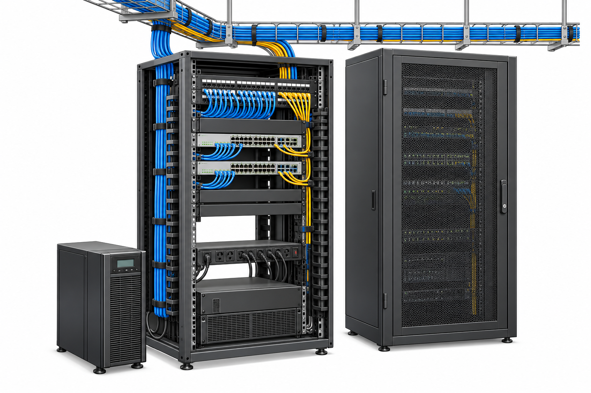

# telecommunications room

**Countable noun. Also called a telecom room or, informally, a wiring closet.** · Chapter 01 · `physical`

[Chapter](../README.md) · [English index](../../../../indexes/ENGLISH-INDEX.md)

*Illustrative scene; equipment appearance and installation vary by site. See the [scene guide](../README.md) for context.*

## Definition

A room used to house telecommunications cabling terminations and associated equipment serving part of a building.

## Usage and distinctions

A telecommunications room is a room; an MDF or IDF is originally a distribution frame. Site teams may use the abbreviations for rooms, so check local drawings.

## Common combinations

provide access to the telecommunications room; inspect the room; room access restrictions

## Examples

> The access switches are in the telecommunications room on the third floor.

> Please confirm who can grant access to the telecommunications room.

## Related entries

[main distribution frame](mdf.md) · [intermediate distribution frame](idf.md) · [equipment rack](equipment-rack.md)

## Sources and review

[S1](../../../../SOURCES.md#s1) Original learning text; draft awaiting independent technical and language review.
