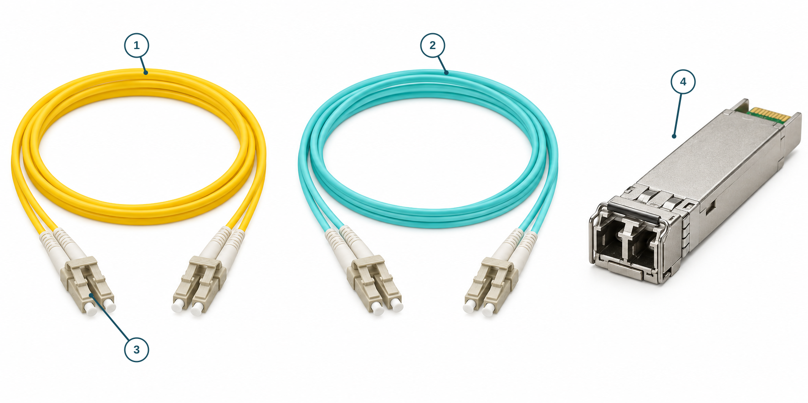

# Optical Fiber

**CHAPTER 02 · VISUAL VOCABULARY**

[Chapter](README.md) · [Copper cabling](01-copper.md)

Match each numbered feature to the word list.

*Illustration for recognition; confirm connector end-face geometry and transceiver compatibility against product documentation. Color is not a reliable proof of fiber type.*

## Picture words

| No. | Word | Meaning |
| --- | --- | --- |
| 1 | [fiber patch cord](entries/fiber-patch-cord.md) | A fiber cable assembly fitted with connectors. |
| 2 | [fiber-optic cable](entries/fiber-optic-cable.md) | A protected assembly carrying optical signals. |
| 3 | [LC connector](entries/lc-connector.md) | A small-form-factor fiber-optic connector. |
| 4 | [optical transceiver](entries/optical-transceiver.md) | A device that transmits and receives optical signals. |

## Examples and usage

> Check that the fiber patch cord matches the optical interface.

> The transceiver uses a duplex LC connection.

> Verify the fiber type and optical link budget before installing the link.

> The connector end face must be inspected according to the site procedure.

## More words

[Single-mode fiber](entries/single-mode-fiber.md) · [Multimode fiber](entries/multimode-fiber.md) · [SC connector](entries/sc-connector.md) · [Duplex fiber](entries/duplex-fiber.md) · [Simplex fiber](entries/simplex-fiber.md) · [SFP](entries/sfp.md) · [Fiber polarity](entries/polarity.md) · [Insertion loss](entries/insertion-loss.md) · [Optical link budget](entries/link-budget.md)
