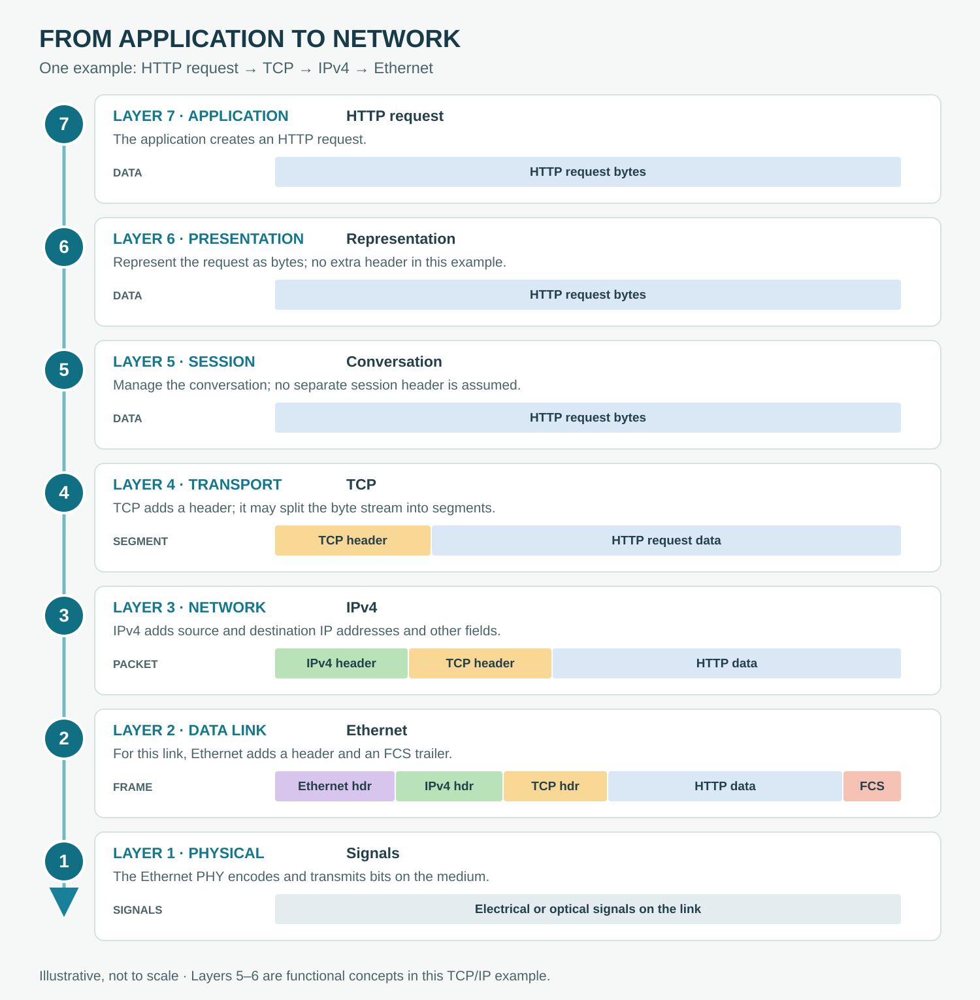

# The OSI Reference Model

**CHAPTER 05 · VISUAL VOCABULARY**

[Chapter](README.md) · [Frames and packets](02-encapsulation.md)

*One simplified example: an HTTP request over TCP, IPv4 and Ethernet. The boxes are not to scale. The OSI model is a conceptual guide; TCP/IP implementations do not necessarily implement seven separate layers.*

## Picture words

| No. | Word | Meaning |
| --- | --- | --- |
| 7 | [application layer](entries/application-layer.md) | Provides application-level protocol functions; in this example, an HTTP request is created. |
| 6 | [presentation layer](entries/presentation-layer.md) | Concerns representation or transformation of data; the request is represented as bytes. |
| 5 | [session layer](entries/session-layer.md) | Concerns organizing a communication session; no separate session header is assumed here. |
| 4 | [transport layer](entries/transport-layer.md) | TCP adds a header to data carried in a TCP segment. |
| 3 | [network layer](entries/network-layer.md) | IPv4 adds a header, producing an IP packet. |
| 2 | [data link layer](entries/data-link-layer.md) | Ethernet carries the IP packet in a frame with an Ethernet header and FCS trailer. |
| 1 | [physical layer](entries/physical-layer.md) | The Ethernet physical interface transmits encoded signals over the medium. |

## Examples and usage

> The application sends an HTTP request over a TCP connection.

> TCP adds source and destination port numbers in its header.

> The IPv4 packet carries the TCP segment as its payload.

> The Ethernet destination MAC address identifies the next hop on the local link.

> At the receiver, each relevant layer processes its own information and passes the remaining data upward.

## Follow the data

**Application data:** The application creates a request. Representation and session functions are shown as OSI concepts, not as mandatory independent headers. This plain HTTP example adds no separate presentation or session header.

**TCP segment:** TCP sends a stream of bytes and adds a TCP header to each segment. A request can span multiple segments, and a segment need not correspond to one complete request. TCP handles sequencing and retransmission as needed.

**IPv4 packet:** An IPv4 header precedes the TCP segment. It includes source and destination IP addresses and identifies TCP as the upper-layer protocol.

**Ethernet frame:** On this example Ethernet link, a link-layer header precedes the IP packet and a frame check sequence follows the frame data. The destination MAC address is the next hop on the local link, which may be a router. Padding may be required for a short frame; an optional VLAN tag is omitted here.

**Signals:** The physical interface encodes the frame for transmission as electrical or optical signals, depending on the medium. The bits are not another protocol header.

## At the receiving end

The receiver processes the frame and IP packet, then TCP reassembles the byte stream for the application. Some checks and processing may be performed by network hardware. A router on the path normally removes and replaces the link-layer frame for each hop; it does not simply forward the original Ethernet frame unchanged.

## More words

[OSI model](entries/osi-model.md) · [TCP/IP model](entries/tcp-ip-model.md) · [Encapsulation](entries/encapsulation.md) · [Decapsulation](entries/decapsulation.md) · [TCP segment](entries/segment.md) · [Packet](entries/packet.md) · [Frame](entries/frame.md)
