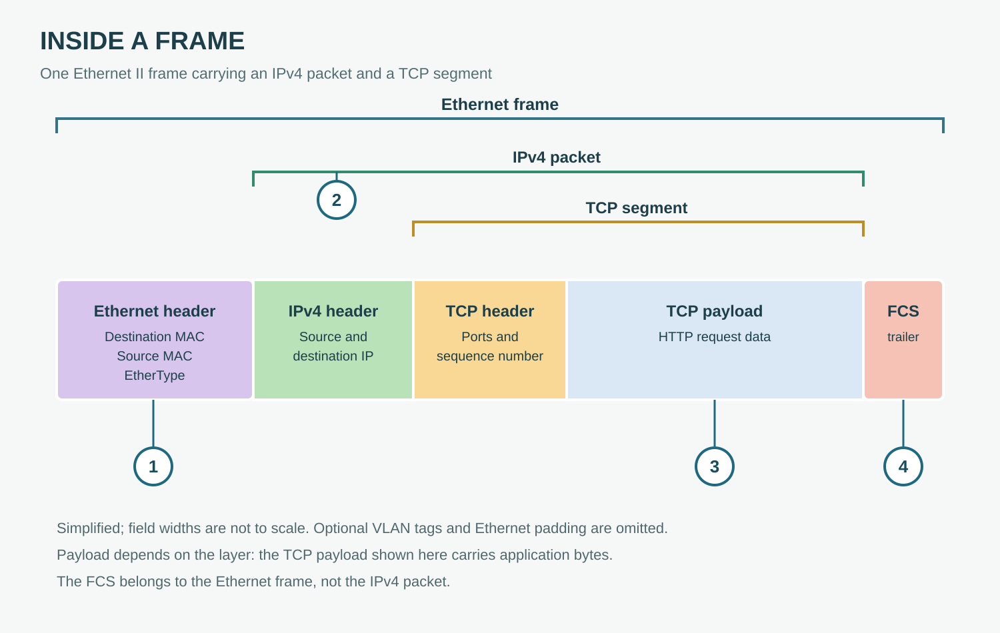

# Frames, Packets, and Encapsulation

**CHAPTER 05 · VISUAL VOCABULARY**

[Chapter](README.md) · [The OSI reference model](01-layers.md)

*One example: HTTP data over TCP, IPv4 and Ethernet II. The blocks are not to scale; optional VLAN tags and Ethernet padding are omitted.*

## Picture words

| No. | Word | Meaning |
| --- | --- | --- |
| 1 | [protocol header](entries/header.md) | Control information placed before data. The marked Ethernet header includes MAC addresses and EtherType. |
| 2 | [packet](entries/packet.md) | A formatted network-layer unit. Here, the IPv4 packet contains an IPv4 header and TCP segment. |
| 3 | [payload](entries/payload.md) | Data carried by a protocol unit. The marked TCP payload contains application bytes in this example. |
| 4 | [protocol trailer](entries/trailer.md) | Information placed after a protocol unit's data. Here, the Ethernet FCS is a trailer. |

## Examples and usage

> The host encapsulates the IPv4 packet in an Ethernet frame.

> The Ethernet destination MAC address identifies the next hop on the local link.

> The IP packet carries a TCP segment as its payload.

> The TCP segment carries part of the HTTP request as its payload.

> A packet capture may not include the Ethernet frame check sequence.

## Follow the frame

**Ethernet header:** For an untagged Ethernet II frame, the header includes destination MAC, source MAC and EtherType. The destination is the receiving host on the local link or the next-hop router.

**IPv4 packet:** The IPv4 packet starts at the IPv4 header and includes the TCP segment. Ethernet padding, if needed, is not part of the IP packet.

**TCP segment:** A TCP segment consists of a TCP header and any data in that segment. The application request can span multiple TCP segments.

**Ethernet trailer:** The frame check sequence helps detect transmission errors. It is outside the IPv4 packet; many capture tools or network adapters do not expose it.

**Payload is relative:** The Ethernet payload carries the IP packet; the IP payload carries the TCP segment; the TCP payload contains application bytes. Each description uses a different layer as its reference.

## More words

[Frame](entries/frame.md) · [TCP segment](entries/segment.md) · [Datagram](entries/datagram.md) · [Encapsulation](entries/encapsulation.md) · [Decapsulation](entries/decapsulation.md) · [MTU](entries/maximum-transmission-unit.md) · [IP fragmentation](entries/fragmentation.md) · [IP reassembly](entries/reassembly.md) · [Protocol data unit](entries/protocol-data-unit.md)
