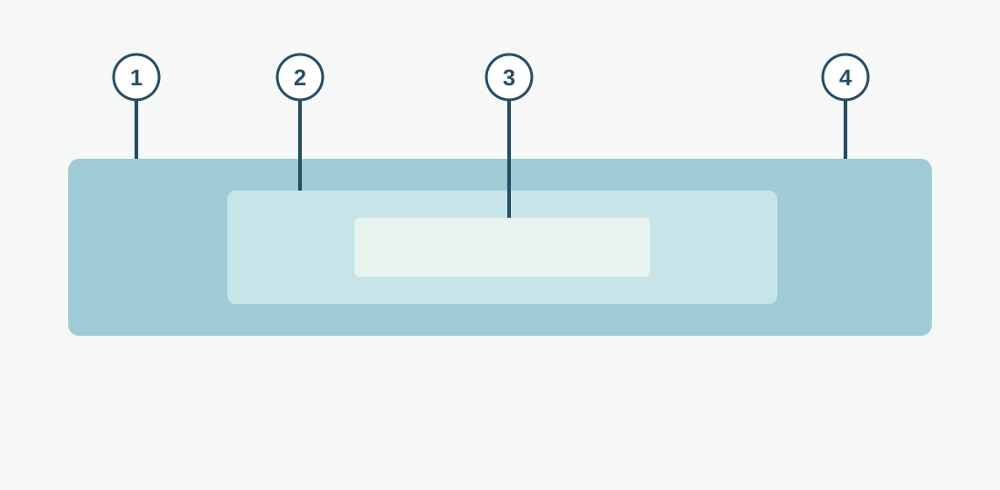

# Frames, Packets, and Encapsulation

**CHAPTER 05 · VISUAL VOCABULARY**

[Chapter](README.md) · [The OSI reference model](01-layers.md)

*A simplified illustration. Actual fields and lengths vary by protocol; not every protocol has a trailer.*

## Picture words

| No. | Word | Meaning |
| --- | --- | --- |
| 1 | [protocol header](entries/header.md) | Control information before associated data. |
| 2 | [packet](entries/packet.md) | A formatted unit transmitted across a packet-switched network. |
| 3 | [payload](entries/payload.md) | Data carried within a protocol unit. |
| 4 | [protocol trailer](entries/trailer.md) | Protocol information after associated data. |

## Examples and usage

> The host encapsulates the IP packet in an Ethernet frame.

> The receiving host processes the frame and then the IP packet.

> The IP packet carries a TCP segment as its payload.

> The capture may not include the Ethernet frame check sequence.

## More words

[Frame](entries/frame.md) · [TCP segment](entries/segment.md) · [Datagram](entries/datagram.md) · [Encapsulation](entries/encapsulation.md) · [Decapsulation](entries/decapsulation.md) · [MTU](entries/maximum-transmission-unit.md) · [IP fragmentation](entries/fragmentation.md) · [IP reassembly](entries/reassembly.md) · [Protocol data unit](entries/protocol-data-unit.md)
