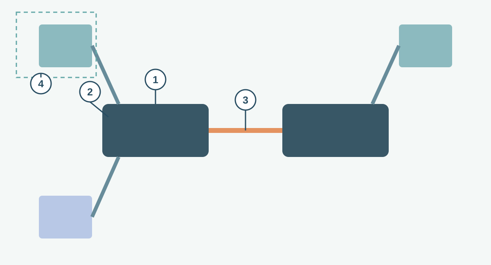

# VLANs and Switch Links

**CHAPTER 06 · VISUAL VOCABULARY**

[Chapter](README.md) · [Ethernet frame](02-frame.md)

*Conceptual diagram. The outlined region indicates logical grouping, not a complete VLAN forwarding map.*

## Picture words

| No. | Word | Meaning |
| --- | --- | --- |
| 1 | [switch](../../part-01/chapter-01-network-rooms-and-facilities/entries/network-switch.md) | A device that forwards frames between connections. |
| 2 | [access port](entries/access-port.md) | A switch port configured for an access VLAN. |
| 3 | [trunk port](entries/trunk-port.md) | A switch port that carries traffic for multiple VLANs. |
| 4 | [virtual LAN](entries/vlan.md) | A logical Layer 2 segmentation. |

## Examples and usage

> The workstation is connected to an access port in VLAN 10.

> The trunk carries VLANs 10 and 20 between the switches.

> Verify the allowed VLAN list on both ends of the trunk.

> Check the MAC address table in the correct VLAN.

## More words

[VLAN tag](entries/vlan-tag.md) · [Native VLAN](entries/native-vlan.md) · [Broadcast domain](entries/broadcast-domain.md) · [Spanning Tree Protocol](entries/spanning-tree-protocol.md) · [Port channel](entries/port-channel.md) · [LACP](entries/lacp.md)
