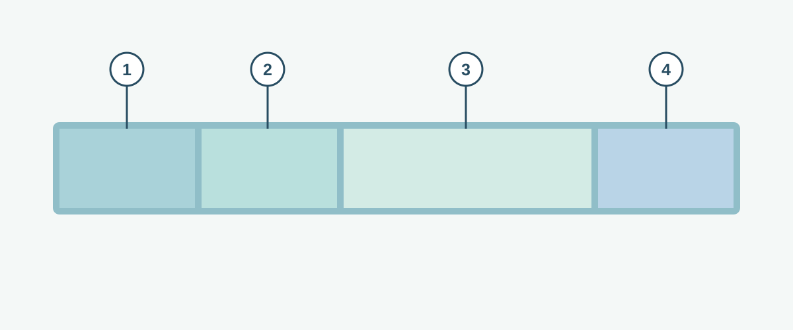

# Ethernet Frames

**CHAPTER 06 · VISUAL VOCABULARY**

[Chapter](README.md) · [VLANs and switch links](01-vlan.md)

*Simplified conceptual illustration. Real frames also contain other fields and may include tags.*

## Picture words

| No. | Word | Meaning |
| --- | --- | --- |
| 1 | [destination MAC address](entries/destination-mac-address.md) | The intended link-layer receiver or group. |
| 2 | [source MAC address](entries/source-mac-address.md) | The link-layer sender address. |
| 3 | [payload](../chapter-05-models-frames-and-packets/entries/payload.md) | The data carried inside the frame. |
| 4 | [trailer](../chapter-05-models-frames-and-packets/entries/trailer.md) | Information after the frame data, including the Ethernet frame check sequence. |

## Examples and usage

> The switch learns the source MAC address on the incoming port.

> The switch looks up the destination MAC address in the relevant VLAN.

> The switch floods an unknown unicast frame within the VLAN, subject to its configuration.

> The capture may not include the frame check sequence.

## More words

[MAC address](entries/mac-address.md) · [MAC address table](entries/mac-address-table.md) · [MAC learning](entries/mac-learning.md) · [Unicast](entries/unicast.md) · [Broadcast](entries/broadcast.md) · [Multicast](entries/multicast.md) · [Unknown unicast](entries/unknown-unicast.md)
