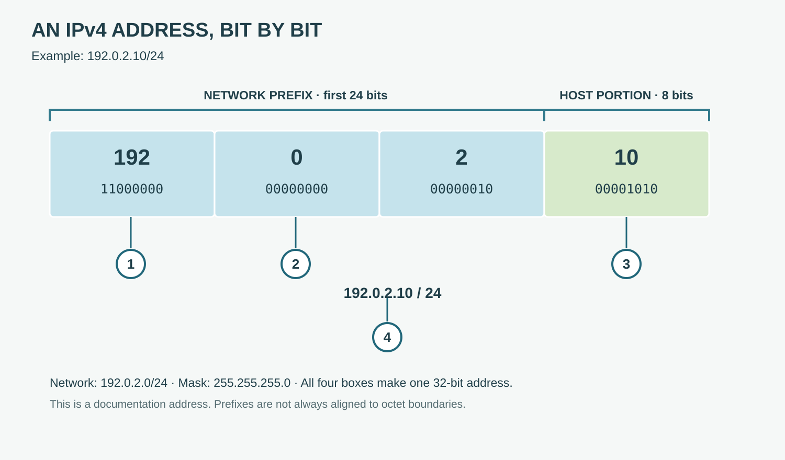

# IPv4 Address and Prefix

**CHAPTER 07 · VISUAL VOCABULARY**

[Chapter](README.md) · [IPv6 address](02-ipv6.md)

The example address is **192.0.2.10/24**. The first 24 bits identify the prefix in this example; the remaining eight bits are the host portion. The address is from a block reserved for documentation.

## Picture words

| No. | Word | Meaning |
| --- | --- | --- |
| 1 | [octet](entries/octet.md) | A group of eight bits. |
| 2 | [network prefix](entries/network-prefix.md) | The leading bits that identify a network or range. |
| 3 | **host portion** | The address bits after the prefix in this example. |
| 4 | [IPv4 address](entries/ipv4-address.md) | A 32-bit address used by IPv4. |

## Examples and usage

> The host address is 192.0.2.10/24.

> The network prefix is 192.0.2.0/24.

> The subnet mask 255.255.255.0 corresponds to /24.

> Check the default gateway before testing remote connectivity.

## More words

[Subnet mask](entries/subnet-mask.md) · [Prefix length](entries/prefix-length.md) · [Subnet](entries/subnet.md) · [IPv4 network address](entries/network-address.md) · [Directed broadcast address](entries/broadcast-address.md) · [Default gateway](entries/default-gateway.md) · [CIDR](entries/cidr.md)

## Reading the example

The prefix is the first 24 bits in this example; the last octet is the host portion. A different prefix length can divide an octet.
