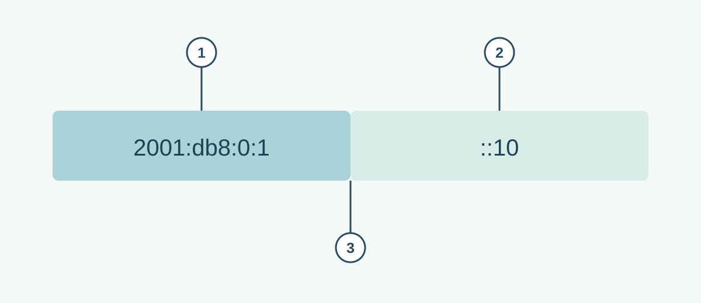

# IPv6 Address and Prefix

**CHAPTER 07 · VISUAL VOCABULARY**

[Chapter](README.md) · [IPv4 address](01-ipv4.md)

The complete example is **2001:db8:0:1::10/64**. The first 64 bits are the prefix in this example. The diagram separates the two portions for teaching; `::` compresses consecutive zero groups and is not an extra separator. This block is reserved for documentation.

## Picture words

| No. | Word | Meaning |
| --- | --- | --- |
| 1 | [network prefix](entries/network-prefix.md) | The leading bits that identify an address range. |
| 2 | [host address](entries/host-address.md) | An address assigned to an interface or endpoint. |
| 3 | [IPv6 address](entries/ipv6-address.md) | A 128-bit IPv6 address. |

## Examples and usage

> The interface uses the IPv6 address 2001:db8:0:1::10/64.

> Verify the IPv6 prefix and default route.

> A link-local address is scoped to the local link.

> IPv6 does not use broadcast addresses.

## More words

[Link-local address](entries/link-local-address.md) · [IPv6 global unicast address](entries/ipv6-global-unicast.md) · [Unique local address](entries/ipv6-unique-local.md) · [Loopback address](entries/loopback-address.md) · [Address allocation](entries/address-allocation.md) · [IP address management](entries/ip-address-management.md)
