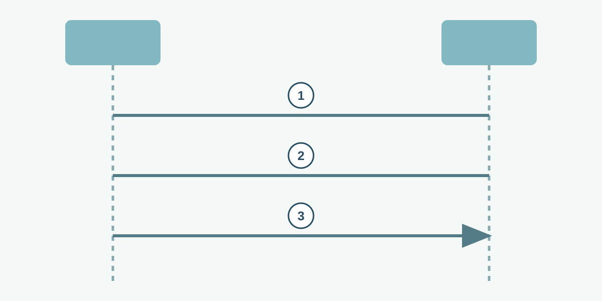

# A TCP Connection

**CHAPTER 08 · VISUAL VOCABULARY**

[Chapter](README.md) · [A DNS query](02-dns.md)

*A simplified usual handshake: the client is on the left and the server on the right. Other TCP behavior and options are omitted.*

## Picture words

| No. | Word | Meaning |
| --- | --- | --- |
| 1 | [SYN](entries/syn.md) | The client initiates synchronization. |
| 2 | [SYN-ACK](entries/syn-ack.md) | The server acknowledges and synchronizes. |
| 3 | [ACK](entries/acknowledgment.md) | The client acknowledges the server’s sequence number. |

## Examples and usage

> The capture shows a completed three-way handshake.

> The server does not respond to the client’s SYN.

> The TCP connection opens, but the application request fails.

> Investigate packet loss and delay when retransmissions increase.

## More words

[TCP](entries/tcp.md) · [UDP](entries/udp.md) · [Port number](entries/port-number.md) · [Source port](entries/source-port.md) · [Destination port](entries/destination-port.md) · [Ephemeral port](entries/ephemeral-port.md) · [TCP retransmission](entries/retransmission.md)
