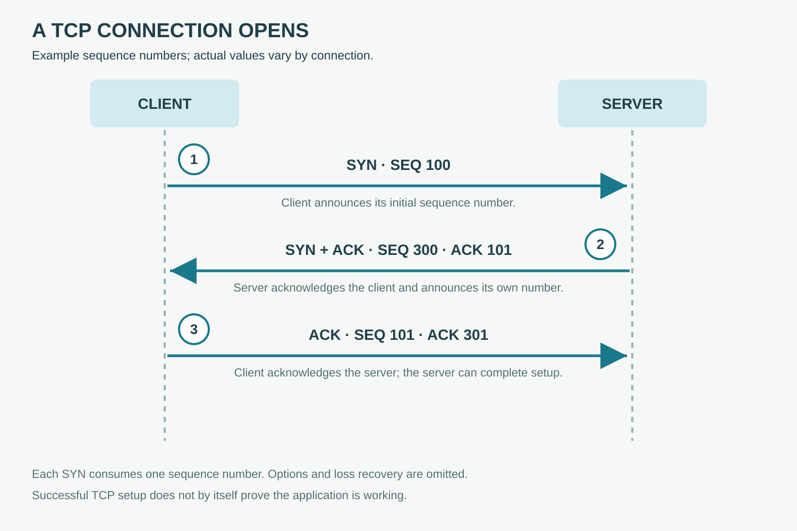

# A TCP Connection

**CHAPTER 08 · VISUAL VOCABULARY**

[Chapter](README.md) · [A DNS query](02-dns.md)

*A simplified usual handshake: the client is on the left and the server on the right. Other TCP behavior and options are omitted.*

## Picture words

| No. | Word | Meaning |
| --- | --- | --- |
| 1 | [SYN](entries/syn.md) | The client initiates synchronization. |
| 2 | [SYN-ACK](entries/syn-ack.md) | The server acknowledges and synchronizes. |
| 3 | [ACK](entries/acknowledgment.md) | The client acknowledges the server’s sequence number. |

## Examples and usage

> The capture shows a completed three-way handshake.

> The server does not respond to the client’s SYN.

> The TCP connection opens, but the application request fails.

> Investigate packet loss and delay when retransmissions increase.

## More words

[TCP](entries/tcp.md) · [UDP](entries/udp.md) · [Port number](entries/port-number.md) · [Source port](entries/source-port.md) · [Destination port](entries/destination-port.md) · [Ephemeral port](entries/ephemeral-port.md) · [TCP retransmission](entries/retransmission.md)

## Follow the exchange

In this example, the client SYN uses sequence 100. The server acknowledges 101 and sends its own SYN with sequence 300. The client then acknowledges 301. These are example values; a SYN consumes one sequence number. TCP can carry data under additional conditions not shown in this simplified exchange.
