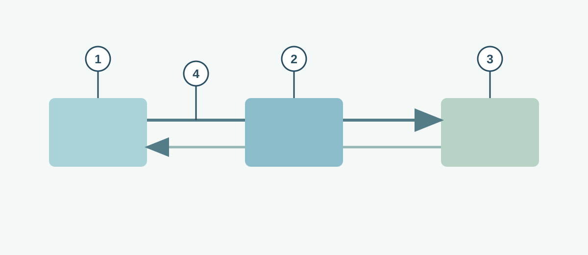

# A DNS Query

**CHAPTER 08 · VISUAL VOCABULARY**

[Chapter](README.md) · [A TCP connection](01-tcp.md)

*A simplified query path. Caches and intermediate DNS servers may change the actual sequence.*

## Picture words

| No. | Word | Meaning |
| --- | --- | --- |
| 1 | [DNS client](entries/dns-client.md) | A program or host function that sends DNS queries. |
| 2 | [recursive resolver](entries/recursive-resolver.md) | A resolver that obtains answers on a client’s behalf. |
| 3 | [authoritative name server](entries/authoritative-name-server.md) | A server that supplies authoritative zone data. |
| 4 | [DNS query](entries/dns-query.md) | A request for DNS information. |

## Examples and usage

> The client sends the DNS query to its configured resolver.

> The resolver may answer from its cache.

> Check the record type and time to live.

> The client can reach the server by IP address, but the name lookup fails.

## More words

[DNS](entries/dns.md) · [DNS resource record](entries/dns-record.md) · [A record](entries/dns-a-record.md) · [AAAA record](entries/dns-aaaa-record.md) · [DNS time to live](entries/dns-ttl.md) · [DHCP](entries/dhcp.md) · [DHCP relay](entries/dhcp-relay.md) · [NTP](entries/ntp.md) · [HTTPS](entries/https.md)
