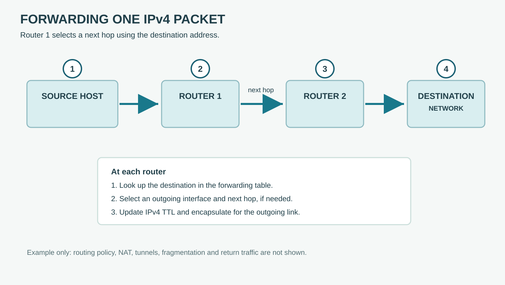

# Forwarding to a Destination

**CHAPTER 09 · VISUAL VOCABULARY**

[Chapter](README.md) · [Longest prefix match](02-prefix.md)

*A simplified path. Routing and forwarding are checked independently at each router.*

## Picture words

| No. | Word | Meaning |
| --- | --- | --- |
| 1 | **source host** | The endpoint that sends the packet. |
| 2 | [router](../../part-01/chapter-03-network-hardware-and-interfaces/entries/router.md) | A device that forwards packets between networks. |
| 3 | [next hop](entries/next-hop.md) | The next forwarding destination from the current router. |
| 4 | [destination prefix](entries/destination-prefix.md) | The address range to which a route applies. |

## Examples and usage

> Check the routing table for the destination prefix.

> Verify that the next hop is reachable.

> The forward and return paths may use different routers.

> A route can exist while forwarding fails.

## More words

[Routing table](entries/routing-table.md) · [Route](entries/route.md) · [Outgoing interface](entries/outgoing-interface.md) · [Static route](entries/static-route.md) · [Dynamic route](entries/dynamic-route.md) · [Default route](entries/default-route.md) · [Return path](entries/return-path.md)

## Follow the example

Router 1 looks up the destination and forwards toward Router 2 as its next hop. Each router makes its own forwarding decision. The return path may differ; NAT and tunnels can alter how addresses and encapsulation appear.
