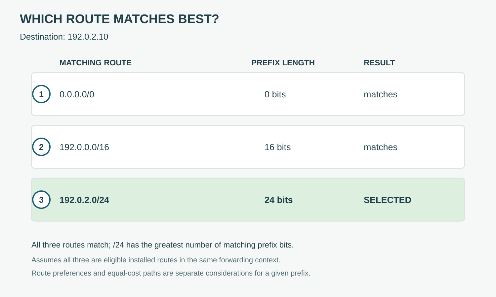

# Longest Prefix Match

**CHAPTER 09 · VISUAL VOCABULARY**

[Chapter](README.md) · [Forwarding to a destination](01-forwarding.md)

*Example: 192.0.2.10 matches all three eligible routes. The /24 has the longest matching prefix.*

## Picture words

| No. | Word | Meaning |
| --- | --- | --- |
| 1 | [default route](entries/default-route.md) | A route for destinations with no more specific match. |
| 2 | [destination prefix](entries/destination-prefix.md) | A route whose prefix covers a range of destination addresses. |
| 3 | [longest prefix match](entries/longest-prefix-match.md) | Selection of the matching route with the greatest prefix length. |

## Examples and usage

> For 192.0.2.10, the matching 192.0.2.0/24 route is selected over 192.0.0.0/16.

> Check for a more specific route before examining the default route.

> Compare route sources only after considering the destination prefix.

> Confirm that the selected route has a reachable next hop.

## More words

[Route metric](entries/route-metric.md) · [Administrative distance](entries/administrative-distance.md) · [Route preference](entries/route-preference.md) · [Equal-cost multipath](entries/equal-cost-multipath.md) · [Recursive route lookup](entries/recursive-route-lookup.md)
0----------------------------------------------9;.llllllllllllllllllllllllllllllllllllllllllllllllllllllllllllllllllllllllllllllllllllllllllllllllllllllllllllllllllllll/

## Follow the example

The destination 192.0.2.10 matches all three listed routes. In this forwarding context, the /24 route is the most specific match. The example assumes those routes are eligible and installed; selection among paths for the same prefix is a separate decision.
