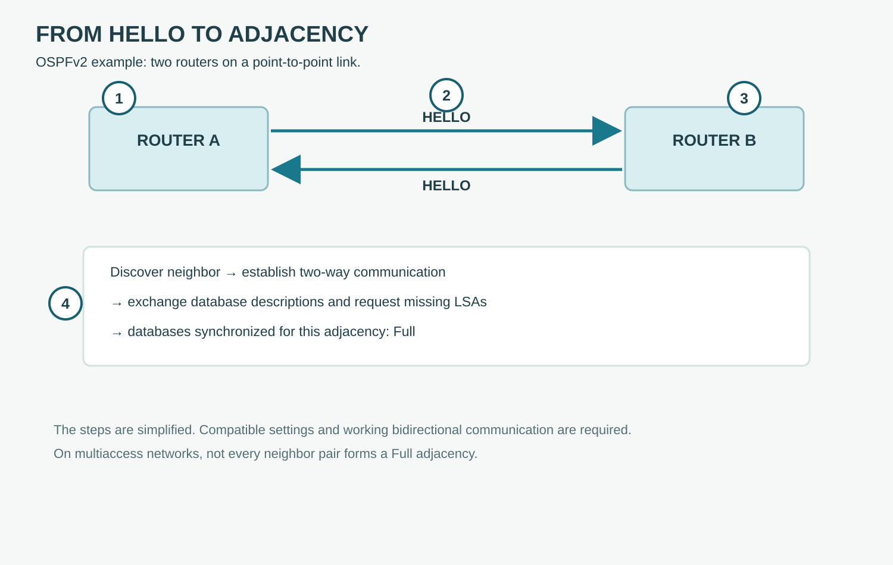

# Neighbor Relationships

**CHAPTER 10 · VISUAL VOCABULARY**

[Chapter](README.md)

*Simplified OSPFv2 example; real network behavior depends on topology and configuration.*

## Picture words

| No. | Word | Meaning |
| --- | --- | --- |
| 1 | [OSPF router](entries/ospf.md) | A router participating in OSPF. |
| 2 | [OSPF hello packet](entries/hello-packet.md) | A message used to discover and maintain neighbors. |
| 3 | [OSPF neighbor](entries/ospf-neighbor.md) | A router discovered through hello exchanges. |
| 4 | [OSPF adjacency](entries/ospf-adjacency.md) | A relationship used to synchronize link-state information. |

## Examples and usage

> The routers exchange hello packets on the link.

> The OSPF adjacency reaches the Full state.

> Check the hello and dead intervals on both ends.

> An OSPF neighbor does not always form a full adjacency.

## More words

[OSPF area](entries/ospf-area.md) · [OSPF backbone area](entries/ospf-backbone-area.md) · [area border router](entries/area-border-router.md) · [OSPF hello interval](entries/hello-interval.md) · [OSPF dead interval](entries/dead-interval.md) · [OSPF designated router](entries/designated-router.md) · [OSPF backup designated router](entries/backup-designated-router.md)

## Follow the example

On a point-to-point link the routers exchange Hellos, discover each other and, when conditions permit, synchronize their databases. Full indicates the adjacency has synchronized; it does not by itself prove that all desired routes are installed or reachable.
