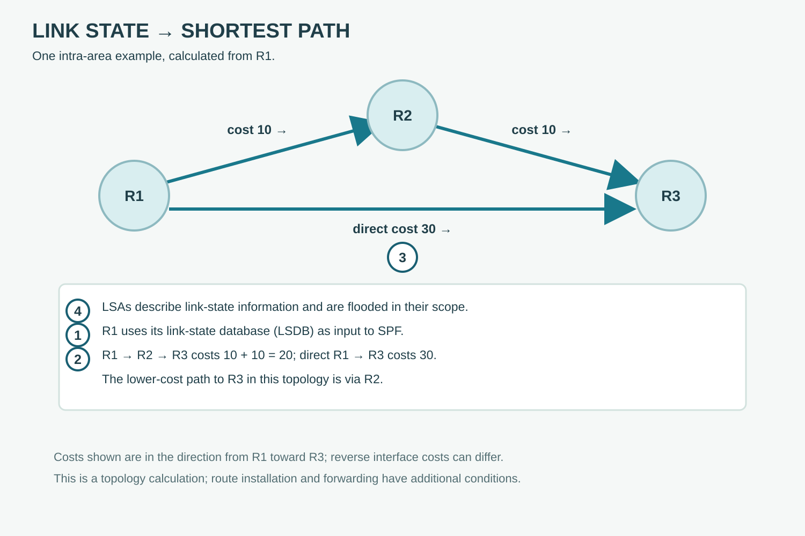

# From Link State to Routes

**CHAPTER 10 · VISUAL VOCABULARY**

[Chapter](README.md)

*Simplified OSPFv2 example; real network behavior depends on topology and configuration.*

## Picture words

| No. | Word | Meaning |
| --- | --- | --- |
| 1 | [link-state database](entries/link-state-database.md) | The topology information held by a router. |
| 2 | [shortest path first](entries/shortest-path-first.md) | A calculation that derives least-cost paths. |
| 3 | [OSPF cost](entries/ospf-cost.md) | A metric associated with an interface or path. |
| 4 | [link-state advertisement](entries/lsa.md) | An OSPF structure carrying link-state information. |

## Examples and usage

> The router floods an updated LSA within its applicable scope.

> The router runs SPF after the topology changes.

> Check the interface cost on both paths.

> Compare the link-state database on the affected routers.

## More words

[Intermediate System to Intermediate System](entries/isis.md) · [IS-IS Level 1](entries/isis-level-1.md) · [IS-IS Level 2](entries/isis-level-2.md) · [IS-IS network entity title](entries/isis-net.md) · [IS-IS link-state PDU](entries/isis-lsp.md) · [Bidirectional Forwarding Detection](entries/bfd.md) · [LSA flooding](entries/lsa-flooding.md)

## Follow the example

R1 calculates a shortest-path tree from the link-state database. In this example the directed cost to R3 through R2 is 20, lower than the direct cost of 30. Reverse-direction interface costs may be different.
