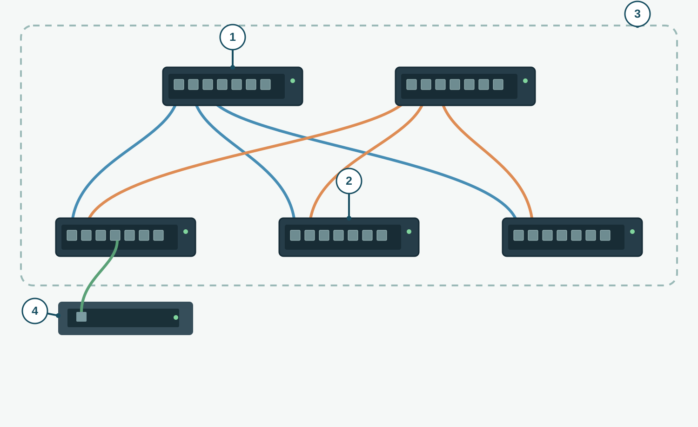

# A Leaf-Spine Fabric

**CHAPTER 15 · VISUAL VOCABULARY**

[Chapter](README.md)

*Simplified physical topology: each leaf has one link to each spine. The dotted outline marks the fabric; device appearance and deployments vary.*

## Picture words

| No. | Word | Meaning |
| --- | --- | --- |
| 1 | [spine switch](entries/spine-switch.md) | A switch providing connectivity between leaves. |
| 2 | [leaf switch](entries/leaf-switch.md) | A switch connecting endpoints to the fabric. |
| 3 | [network fabric](entries/fabric.md) | The collection of network devices providing connectivity. |
| 4 | **server** | An endpoint connected to a leaf switch in this example. |

## Examples and usage

> Each leaf connects to the spine switches in this simplified topology.

> The server connects to a leaf switch.

> Check the leaf uplinks to both spines.

> The fabric connects the server racks.

## More words

[top-of-rack switching](entries/top-of-rack.md) · [data center network](entries/data-center-network.md) · [leaf-spine topology](entries/leaf-spine.md) · [end-of-row switching](entries/end-of-row.md) · [east-west traffic](entries/east-west-traffic.md) · [north-south traffic](entries/north-south-traffic.md) · [data center interconnect](entries/data-center-interconnect.md) · [network oversubscription](entries/oversubscription.md)
