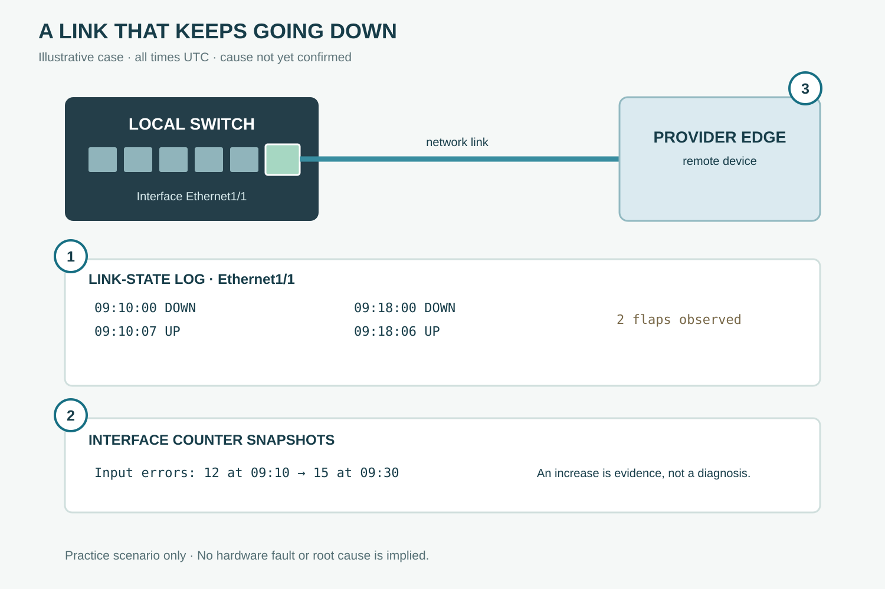

# Interface Flapping: Talking to the Provider

**CHAPTER 22 · WORK SCENARIO · SPEAKING PRACTICE**

[Chapter](README.md) · [Contents](../../../TABLE-OF-CONTENTS.md)

*Practice scenario: the timestamps, interface and counters are invented. The cause and service impact have not been confirmed.*

## Professional expressions

| No. | Word | Meaning |
| --- | --- | --- |
| 1 | The interface went down twice between 09:10 and 09:19 UTC. | Report the observed events and their time window. |
| 2 | The input-error counter increased from 12 to 15 between 09:10 and 09:30 UTC. | Give a counter change with both readings and times. |
| 3 | Could you check the corresponding port on your side for the same time window? | Ask the provider to investigate its side. |

## The situation

You are a network engineer investigating a link to a provider. The local logs show two down-and-up events. At 09:30 UTC the interface is up, and the input-error counter has increased. You need to share what you know, ask the provider to check its side, and give a clear update. The cause and service impact remain unconfirmed.

## A conversation with the provider

**You:** Hi, our Ethernet1/1 interface went down twice between 09:10 and 09:19 UTC. Could you check the corresponding port on your side for the same time window?

**Provider:** Certainly. Is the interface currently up, and have you seen any errors on your side?

**You:** It is up as of 09:30 UTC. The input-error counter increased from 12 to 15 between 09:10 and 09:30 UTC. We have not confirmed whether that increase is related to the link-state changes.

**Provider:** Understood. We will review the port logs and counters. Could you share the event timestamps and your circuit reference?

**You:** Of course. I will send the timestamps in UTC and the circuit reference in the ticket. Could you also let us know when we can expect your next update?

## Expressions you can reuse

**Report an observation:** We saw [number] link-state changes on [interface] between [start time] and [end time].

**Give a current status:** The interface is up as of [time], but we are still investigating the earlier events.

**Share evidence:** The [counter name] increased from [first reading] to [second reading] between [start time] and [end time].

**Avoid jumping to a conclusion:** We have not confirmed whether [observation A] is related to [observation B].

**Request a check:** Could you check [the corresponding port / the circuit] on your side for [time window]?

**Request evidence:** Could you share the port logs and counter readings for the same period?

**Ask for an update:** Could you let us know when we can expect your next update?

## Choose the right wording

**Went down twice** describes two past events. **Is up as of 09:30 UTC** reports the status at a particular time; it does not promise the link will remain stable.

**We have not confirmed the cause** communicates uncertainty clearly. Avoid saying **the provider port caused the issue** unless the evidence supports that conclusion.

**Could you check …?** is a polite request. Add the port, time window and evidence you need so the other team can act on it.

## Written status update

At 09:30 UTC, Ethernet1/1 is up. It went down twice between 09:10 and 09:19 UTC. The local input-error counter increased from 12 to 15 between 09:10 and 09:30 UTC; its relationship to the link-state changes has not been confirmed. We have asked the provider to review the corresponding port logs and counters. The cause and service impact are still being investigated. Our next update is scheduled for 10:00 UTC.

## Try it yourself

At 14:20 UTC, your uplink is up. It went down twice between 14:00 and 14:10 UTC. The cause and service impact are unknown. Write a request asking the provider to check its port logs for that time window, then write a short status update.

## Model answer

**Provider request:** Could you check the logs for the corresponding port between 14:00 and 14:10 UTC and share any relevant events?

**Status update:** At 14:20 UTC, the uplink is up. It went down twice between 14:00 and 14:10 UTC. The cause and service impact have not yet been confirmed. We have asked the provider to review its port logs for the same period.
